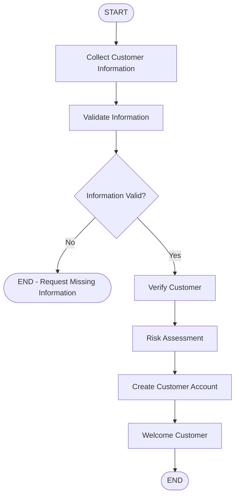

# 🤖 Customer Onboarding Agent

### A Stateful Customer Onboarding Workflow using LangGraph and Streamlit

A Python-based customer onboarding application that collects customer information, validates input, and processes a structured onboarding workflow using LangGraph.

The application provides an interactive chat interface built with Streamlit and uses LangGraph state management and checkpoint-based memory to maintain customer conversations.

---

## 📸 Project Screenshots

### 1. Customer Information Collection

The agent collects customer name and email, then asks for the remaining required information.


### 2. Completed Customer Onboarding

After collecting and validating all required information, the workflow performs verification, risk assessment, account creation, and displays a welcome message.


---

## ✨ Features

- Interactive chatbot interface using Streamlit.
- Customer name extraction.
- Email extraction and validation.
- Pakistani mobile number extraction and validation.
- Stateful workflow using LangGraph.
- Conditional routing based on validation results.
- Customer verification workflow.
- Demonstration risk assessment.
- Demonstration account creation.
- Checkpoint-based conversation memory.
- Separate customer sessions using unique Thread IDs.

---

## 🛠️ Technologies Used

- Python
- LangGraph
- LangChain Core
- Streamlit
- Regular Expressions (Regex)
- UUID
- Git & GitHub

---

## 🔄 Workflow Architecture

The project follows a structured LangGraph workflow.



### Workflow Explanation

1. **Collect Information:** Extracts customer name, email, and phone number from user messages.
2. **Validate Information:** Checks required fields and validates email and Pakistani mobile number formats.
3. **Conditional Routing:** Determines whether the workflow should continue or request missing/invalid information.
4. **Verify Customer:** Demonstrates customer information verification.
5. **Risk Assessment:** Assigns a demonstration risk level.
6. **Create Account:** Simulates customer account creation.
7. **Welcome Customer:** Displays the onboarding completion message.

---

## 📁 Project Structure

```text
LangGraph-Customer-Onboarding-Agent/
│
├── app.py
├── graph.py
├── state.py
├── requirements.txt
├── README.md
├── .gitignore
│
└── screenshots/
    ├── 01-information-collection.png
    └── 02-completed-onboarding.png
```

---

## ⚙️ Installation and Setup

### 1. Clone the Repository

```bash
git clone https://github.com/mehakrajpoot-codes/LangGraph-Customer-Onboarding-Agent.git
```

### 2. Open Project Directory

```bash
cd LangGraph-Customer-Onboarding-Agent
```

### 3. Create Virtual Environment

```bash
python -m venv .venv
```

### 4. Activate Virtual Environment

**Windows:**

```bash
.venv\Scripts\activate
```

### 5. Install Dependencies

```bash
pip install -r requirements.txt
```

### 6. Run the Application

```bash
streamlit run app.py
```

The application will open in your browser.

---

## 💬 Example Interaction

**User:**
My name is Ali

**Agent:**
I still need the following information: email, phone.

**User:**
ali@gmail.com

**Agent:**
I still need the following information: phone.

**User:**
03001234567

**Agent:**
Great! Your customer information has been validated successfully.

The workflow then continues with:

- Customer Verification
- Risk Assessment
- Account Creation
- Welcome Message

---

## 🧠 LangGraph Concepts Implemented

This project demonstrates practical implementation of:

- StateGraph
- TypedDict-based state management
- Graph Nodes
- START and END
- Conditional Edges
- State Persistence
- MemorySaver Checkpointing
- Thread-based Conversation Management

---

## ⚠️ Current Limitations

This is a learning and demonstration project.

- Information extraction uses Regex patterns rather than an LLM.
- Customer verification is simulated.
- Risk assessment currently uses a fixed LOW risk level.
- Account creation is simulated and does not use a real database.
- MemorySaver stores checkpoint data in memory and does not provide permanent storage.

---

## 🚀 Future Improvements

- Integrate an LLM for intelligent information extraction.
- Add database integration for customer records.
- Implement real customer verification.
- Develop intelligent risk assessment.
- Add persistent database-backed conversation memory.
- Add automated testing and deployment.

---

## 👩‍💻 Author

**Mehak Fatima**

Aspiring AI Engineer | Python Developer | Agentic AI Enthusiast

Interested in building AI applications, intelligent agents, and stateful workflows using Python, LangGraph, and modern AI technologies.

---

**Built with ❤️ using Python, LangGraph, and Streamlit.**
